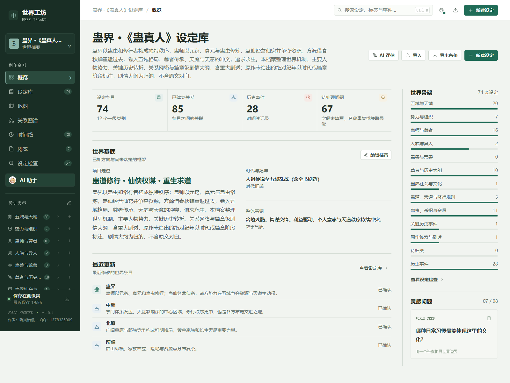
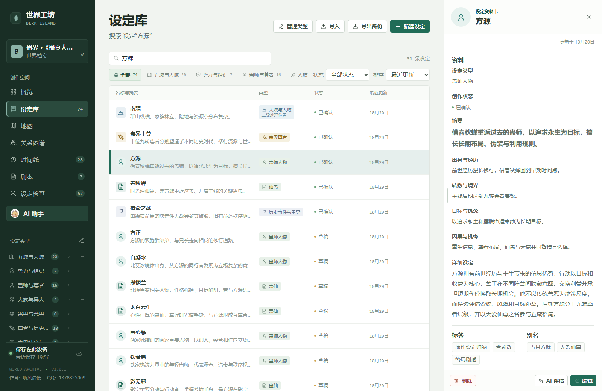
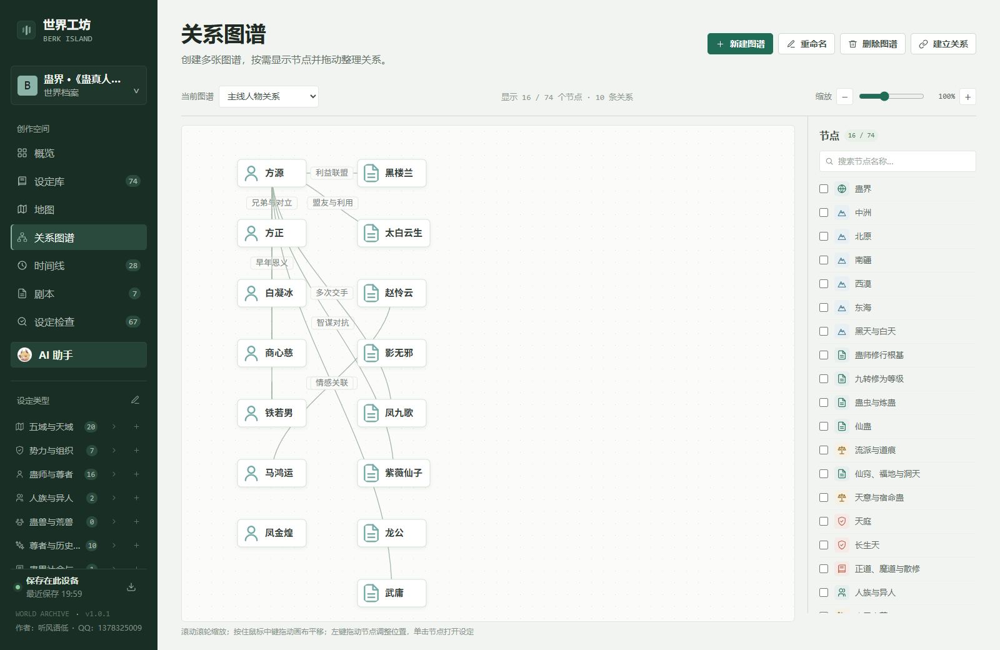
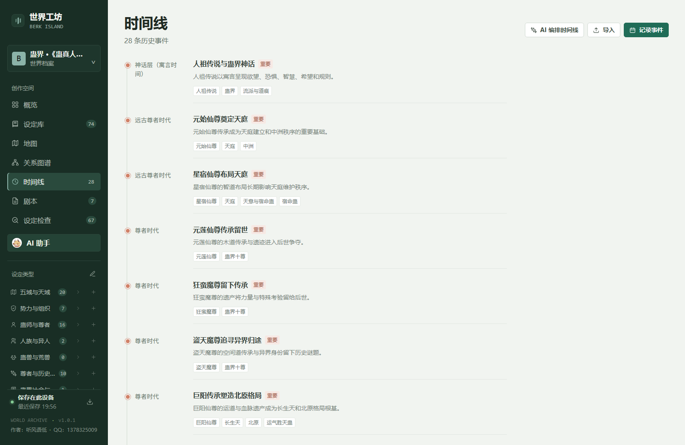
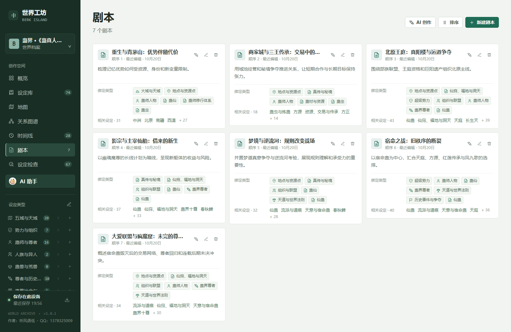

# 世界工坊 · 伯克岛

面向小说作者、游戏设计者、跑团主持与互动叙事创作者的世界观构建平台。支持自定义设定类型与字段，将世界规则、人物、势力、地点、事件和剧情资料放进同一份可检索、可关联、可持续扩展的世界档案。

世界工坊目前以本地网页应用的形式运行。产品愿景是进一步接入可管理的 AI 智能体：让不同智能体共享经作者确认的世界资料，协助整理设定、提供创作灵感，并通过多智能体分角色演绎剧情，帮助作者试演人物关系、冲突和故事走向。

**作者：** 听风语低　·　**联系 QQ：** 1378325009　·　**版本：** v1.0.1

## 产品目标与当前版本

下表区分产品方向与 v1.0.1 已具备的能力。“规划中”表示当前版本尚未实现。

| 功能方向 | 目标功能 | 当前版本已有功能 |
| --- | --- | --- |
| 世界观构建 | 为小说和游戏项目集中管理世界规则、人物、地点、势力、物品与资料，并保持它们之间的联系。 | **已实现基础工作台：** 世界概览、设定库、自定义类型与字段；支持文本、图片、专属图标和多边形数值，可调整字段及资料卡顺序。 |
| AI 智能体管理 | 接入多个分工明确的智能体，为它们配置角色、任务和可参考的世界资料，并管理协作过程。 | **规划中：** 当前提供单个可配置的 AI 助手，可设置聊天模型接口；还没有智能体列表、角色配置和多智能体协作管理。 |
| 创作灵感 | 根据已有设定生成角色动机、势力矛盾、地点钩子、任务和剧情可能性，并标清建议与正典的区别。 | **部分实现：** 可让 AI 助手评估或扩展设定、整理时间线和编写剧本，也能在对话中索要灵感；尚无独立的灵感库与结构化生成流程。 |
| 多智能体剧情演绎 | 让多个智能体分别扮演角色、旁白或主持人，围绕同一世界设定试演场景、对话与剧情分支。 | **规划中：** 当前有剧本管理和单个 AI 助手辅助创作，尚不支持多个角色智能体同时演绎或自动模拟剧情。 |
| 剧情与空间关系 | 从时间、地理和人物关系等角度组织故事材料，帮助检查事件顺序和角色关联。 | **已实现基础工具：** 支持时间线、剧本、多张地图和多张关系图谱；地图可添加设定标记，图谱节点可隐藏、拖动和缩放。 |
| 设定检查 | 发现设定缺漏、前后矛盾、人物动机冲突和时间线问题，辅助作者维护一致性。 | **部分实现：** 设定检查可提示未填写字段和重复名称等问题；深层语义矛盾和剧情因果检查尚未实现。 |
| 资料与图像 | 将参考文档、图片和视觉素材纳入世界档案，供创作流程查阅。 | **已实现基础支持：** 可为设定上传图片和专属图标、导入地图底图，并向 AI 助手附加文档或图片；可配置兼容的图片生成接口。 |
| 档案与备份 | 让作者持续保存和迁移自己的世界资料。 | **已实现本地档案：** 数据保存在当前浏览器，可导入模板并导出备份；当前没有账号系统或云端同步。 |

## 当前版本功能详解

以下功能截图使用《蛊真人》世界观模板作为示例档案，在应用实际界面中截取。该模板包含大量设定、关系、历史事件和剧本，便于展示不同创作工具如何共同组织同一份世界档案。

### 世界概览与世界基底

概览页集中展示世界名称、题材定位、时代纪年、整体基调与核心设想，并统计设定条目、人物关系、历史事件和待处理问题。侧栏按设定类别显示资料覆盖情况，也提供可切换的灵感问题，方便从已有框架继续扩写。



*示例档案包含 74 条设定、85 条关系和 28 条历史事件；待处理项用于提示模板中尚待补充的字段等问题。*

### 设定库与自定义设定类型

设定库支持创建、编辑和归档世界条目，并可按名称、正文、标签或别名搜索；也能按设定类别、次级类型和创作状态筛选，再按名称、类型或更新时间排序。地理类条目可建立上下级位置关系。

可自定义一级类别、次级类型及各类型的专属字段。文本、图片、专属图标和多边形数值都可以作为字段类型；内置通用字段保留为默认字段，但可以调整位置。通用字段、专属字段及资料卡的显示顺序都可调整，保存后条目资料卡会按设定顺序展示。专属图标字段可替换条目和关系节点的默认图标，上传后可以用圆形裁切范围调整头像。



*方源资料卡展示了自定义人物类型、摘要、专属字段、详细设定、标签和别名。*

### 地图

一个世界档案可创建多张地图。每张地图可以上传底图、选择允许放置的设定类型，并将已有地点或其他条目标记到地图上；可以拖动标记调整位置，用滚轮缩放地图，并按住鼠标中键拖动画布视角。《蛊真人》示例档案目前没有预置地图底图，因此这里不展示空白地图截图。

### 关系图谱

关系图谱可创建多张独立图谱，并为每张图谱选择要显示的设定节点。节点可以隐藏或显示、拖动调整位置；关系线上显示关联类型，节点可使用条目图标。滚轮用于缩放，中键按住拖动画布；缩小到精简比例后，有专属图标的节点只显示图标，没有专属图标的节点只显示名称。



*主线人物图谱展示节点筛选、人物图标、关系标签和节点连线。*

### 时间线

时间线按自定义时间标记与排序值展示历史事件。每条事件可填写摘要和正文、设置重要程度，并关联相关人物、势力或地点，方便沿同一条时间轴检查因果和历史转折。AI 助手也可根据世界档案协助整理时间线。



### 剧本

剧本区支持创建多份剧本，分别维护标题、简介和正文，并可绑定相关的次级设定类型。剧本可拖动排序，也可交给 AI 助手按要求协助修改；绑定类型后可以从剧本卡片跳转到相关设定。



### AI 助手与创作辅助

作者可以自行配置兼容的聊天模型接口、模型名称和密钥。助手会结合当前档案检索相关设定，并可切换自由对话、添加或修改设定、时间线编排、剧本编排、地图标记规划、评估设定、前后矛盾检查和正文润色等任务。生成的档案修改由作者确认后应用，不会把建议自动写成正典。

对话中可以附加文档或图片作为参考资料；需要生成配图时，也可以配置兼容的图片生成接口。当前版本提供的是单个 AI 助手，多智能体的角色管理、协作与剧情演绎仍属于后续目标。

### 设定检查

设定检查会列出各条目未填写的内置或专属字段、重复名称和指向不存在条目的关系，也会提示规则、地理、势力或时间线等基础类别是否尚未建立。缺漏提示与明确问题分开呈现，便于逐项补全。跨条目的深层语义矛盾、人物动机冲突和剧情因果审查尚未实现。

### 模板、资料与图片

仓库提供 16 个可导入的题材模板，包含仙侠、星际战争、剑与魔法、废土生存、蒸汽朋克、虚拟 AI、历史架空、都市超能、克苏鲁恐怖、时间穿梭、经典奇幻、原始世界、多维度、失落文明、无限流和镜面倒影等方向。模板可以继续修改，也能作为新档案的起点。

设定条目可上传图片或专属图标，图片字段支持最大 10 MB 的文件；地图可使用图片底图。AI 助手支持附加 PDF、DOCX、文本、表格、JSON 等文档和常见图片格式作为创作参考，生成图片则需自行配置相应接口。

### 本地档案与备份

世界档案会自动保存在当前浏览器，并可导出 JSON 备份或从模板、备份文件导入。项目目前没有账号系统和云端同步；更换浏览器、访问地址或清理站点数据前，请先导出备份。导入档案会替换当前浏览器中的活动档案。

多智能体管理、多个角色协同演绎剧情和自动化的深层一致性审查属于产品目标，尚未在 v1.0.1 中提供。

## 启动

需要 Python 3.7 或更新版本，以及较新的 Chrome、Edge 或 Firefox 浏览器。

在此目录打开 PowerShell，启动本地网页服务：

```powershell
py -3 -m http.server 8000 --bind 127.0.0.1
```

然后在浏览器打开 <http://127.0.0.1:8000/>。使用结束后，在 PowerShell 窗口按 `Ctrl+C` 停止服务。macOS 或 Linux 可将 `py -3` 换成 `python3`。

DOCX 和 PDF 导入组件已包含在 `vendor/` 目录中，不需要额外安装 JavaScript 依赖。

## 数据与备份

- 世界档案、上传的图片和 AI 设置保存在当前浏览器的本地存储中，不会随代码提交到仓库。
- 更换浏览器、访问地址或清除站点数据后，本地档案不会自动迁移。请使用应用内的“导出备份”和“导入”功能转移档案。
- 使用远程 AI 服务时，发送给 AI 的内容会传到设置中指定的服务。

## 世界模板

题材模板保存在 `模板/` 目录。模板分别提供世界概览基底、题材化设定分类和可调整字段，可在应用中通过“导入”载入。模板目录中的 `README.md` 列出了当前模板。

**导入模板会替换当前浏览器中的活动档案。**请先用应用的“导出备份”保存已有内容。

## 目录

- `index.html`：网页入口
- `app.js`：应用逻辑
- `style.css`：界面样式
- `vendor/`：DOCX 与 PDF 解析组件及许可证
