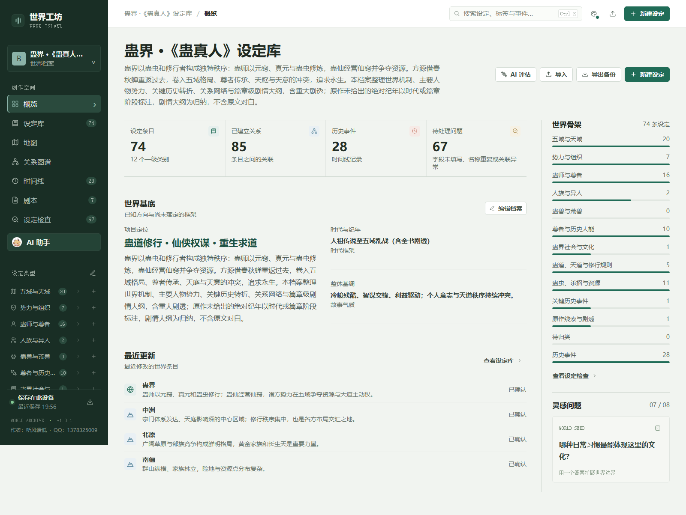
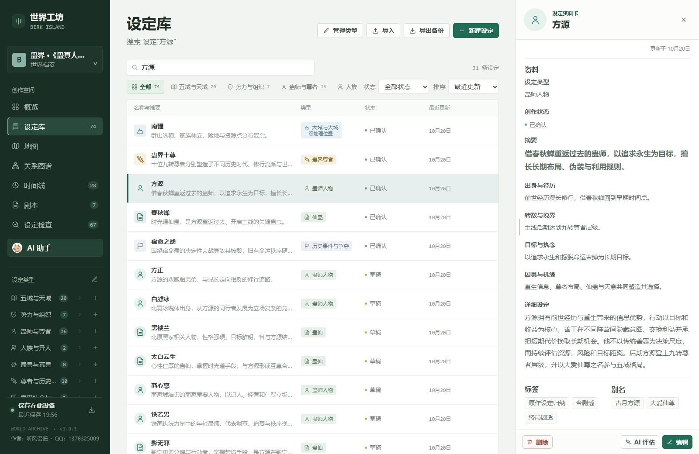
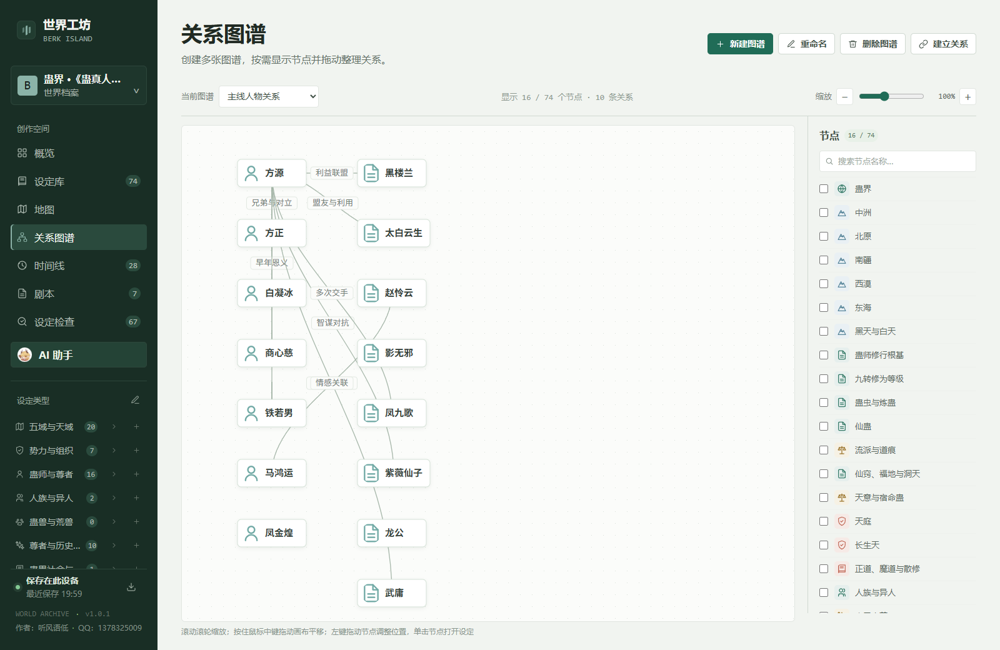
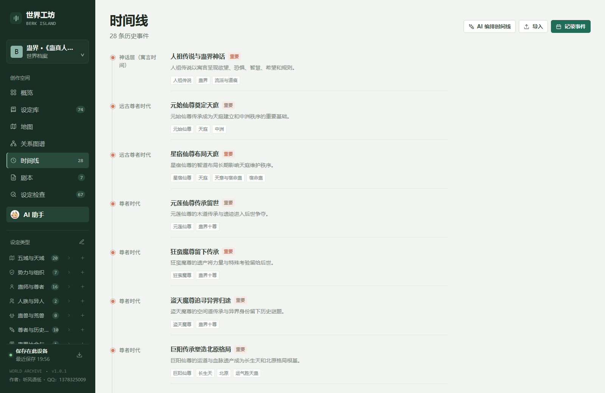
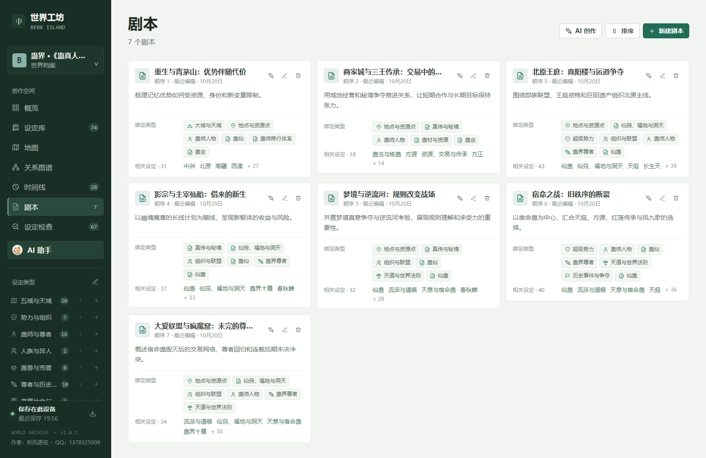

# 世界工坊

面向小说作者、游戏设计者、跑团主持与互动叙事创作者的世界观构建平台。支持自定义设定类型与字段，将世界规则、人物、势力、地点、事件和剧情资料放进同一份可检索、可关联、可持续扩展的世界档案。

世界工坊提供网页、PWA、Windows 本机网页启动包、Windows 桌面包和 Android 独立应用。Windows 网页启动包体积小，解压后双击启动脚本即可用浏览器打开本机网页；网页与 PWA 支持手机窄屏布局；Android 版通过 Capacitor 封装现有应用，可构建独立 APK。产品愿景是进一步接入可管理的 AI 智能体：让不同智能体共享经作者确认的世界资料，协助整理设定、提供创作灵感，并通过多智能体分角色演绎剧情，帮助作者试演人物关系、冲突和故事走向。

**作者：** 听风语低　·　**联系 QQ：** 1378325009　·　**版本：** v1.3.0

## v1.3.0 下载与更新说明

发布于 2026-10-31。相对 GitHub 上次版本的完整变更见 [v1.3.0 更新说明](docs/更新说明-v1.3.0-20261031.md)。

| 使用方式 | 下载 | 打开方式 |
| --- | --- | --- |
| 网页版（Windows 本机启动包，含可部署网页资源） | [下载网页 ZIP](https://github.com/1378325009-collab/world-workshop/releases/download/v1.3.0/世界工坊-1.3.0-网页端-Windows-x64.zip) | 完整解压后，双击“启动世界工坊.bat” |
| Android 手机 App | [下载 APK](https://github.com/1378325009-collab/world-workshop/releases/download/v1.3.0/世界工坊-1.3.0-Android.apk) | 传到手机后安装；已有同签名版本可覆盖更新 |

[发布页与文件校验值](https://github.com/1378325009-collab/world-workshop/releases/tag/v1.3.0)。网页包内的 `web/` 可单独部署到 HTTPS 静态站点，供电脑和手机浏览器使用；Windows 启动脚本仅供本机访问。Android APK 使用既有调试签名，适合直接安装；当前不提供 iOS 安装包。

## 产品目标与当前版本

下表区分产品方向与 v1.3.0 已具备的能力。“规划中”表示当前版本尚未实现。

| 功能方向 | 目标功能 | 当前版本已有功能 |
| --- | --- | --- |
| 世界观构建 | 为小说和游戏项目集中管理世界规则、人物、地点、势力、物品与资料，并保持它们之间的联系。 | **已实现基础工作台：** 世界概览、设定库、自定义类型与字段；提供默认图标字段，可上传图片用于条目图标，次级类型图标优先于一级分类通用图标；文本、图片和多边形数值字段可调整顺序。 |
| AI 智能体管理 | 接入多个分工明确的智能体，为它们配置角色、任务和可参考的世界资料，并管理协作过程。 | **规划中：** 当前提供单个可配置的 AI 助手，可设置聊天模型接口；还没有智能体列表、角色配置和多智能体协作管理。 |
| 创作灵感 | 根据已有设定生成角色动机、势力矛盾、地点钩子、任务和剧情可能性，并标清建议与正典的区别。 | **部分实现：** 可让 AI 助手评估或扩展设定、整理时间线和编写剧本，也能在对话中索要灵感；尚无独立的灵感库与结构化生成流程。 |
| 多智能体剧情演绎 | 让多个智能体分别扮演角色、旁白或主持人，围绕同一世界设定试演场景、对话与剧情分支。 | **规划中：** 当前有剧本管理和单个 AI 助手辅助创作，尚不支持多个角色智能体同时演绎或自动模拟剧情。 |
| 剧情与空间关系 | 从时间、地理和人物关系等角度组织故事材料，帮助检查事件顺序和角色关联。 | **已实现基础工具：** 支持时间线、剧本、多张地图和多张关系图谱；图谱提供浏览、选区和关联模式，支持框选节点后整体移动，手机上可在关联模式点选两个节点建立关系。 |
| 设定检查 | 发现设定缺漏、前后矛盾、人物动机冲突和时间线问题，辅助作者维护一致性。 | **部分实现：** 设定检查可提示未填写字段和重复名称等问题；深层语义矛盾和剧情因果检查尚未实现。 |
| 资料与图像 | 将参考文档、图片和视觉素材纳入世界档案，供创作流程查阅。 | **已实现基础支持：** 每个类型默认提供图标字段，可上传图片作为条目和关系节点图标；也可上传普通设定图片、导入地图底图，并向 AI 助手附加文档或图片；可配置兼容的图片生成接口。 |
| 档案与备份 | 让作者持续保存和迁移自己的世界资料。 | **已实现本地档案：** 数据保存在当前浏览器或 Android 应用，可导入模板并导出备份；当前没有账号系统或云端同步。 |
| 手机与离线访问 | 在手机上方便地浏览和编辑世界档案，并能在网络不稳定时打开应用。 | **已实现：** 手机窄屏界面、触屏画布拖动与双指缩放、PWA 安装入口；Android 可通过 Capacitor 构建独立 APK，应用资源内置并支持离线启动、系统返回键和分享导出。档案仍保存在各设备自己的本地存储中。 |

## 当前版本功能详解

以下功能截图使用《蛊真人》世界观模板作为示例档案，在应用实际界面中截取。该模板包含大量设定、关系、历史事件和剧本，便于展示不同创作工具如何共同组织同一份世界档案。

### 世界概览与世界基底

概览页集中展示世界名称、题材定位、时代纪年、整体基调与核心设想，并统计设定条目、人物关系、历史事件和待处理问题。侧栏按设定类别显示资料覆盖情况，也提供可切换的灵感问题，方便从已有框架继续扩写。

2026-10-28 的界面优化采用 MotionSites 收录的 Emil Design Engineering 技能：概览统计改为可点击的导航卡片，统一内容卡片和控件层次，分开展示设定类别与排序筛选，并整理图谱模式、AI 输入区和手机布局。详见 [界面优化说明](docs/design-polish-20261028.md)。




### 设定库与自定义设定类型

设定库支持创建、编辑和归档世界条目，并可按名称、正文、标签或别名搜索；也能按设定类别、次级类型和创作状态筛选，再按名称、类型或更新时间排序。地理类条目可建立上下级位置关系。

可自定义一级类别、次级类型及各类型的字段。文本、图片和多边形数值可以作为自定义字段；每个一级类别和次级类型都默认包含专属图标字段，不能删除，可上传图片并用圆形裁切范围调整图标。一级分类图标作为通用回退，次级类型图标优先显示，可替换条目和关系节点的默认图标。内置通用字段保留为默认字段，但可以调整位置；通用字段、专属字段及资料卡的显示顺序都可调整，保存后条目资料卡会按设定顺序展示。




### 地图

一个世界档案可创建多张地图。上传底图后，全部已有设定会自动按设定类型收录到右侧图层，新建设定也会自动加入；收录条目默认未标注，需要手动选择地图位置。类型组初次折叠，可用箭头或组名展开，搜索类型或设定名称会展开匹配结果，清空搜索恢复原来的展开状态。点击未标注条目的名称或定位按钮，再点击地图即可放置标记；点击已有可见条目的名称可选中并定位到其标记。眼睛分别控制整个类型组或单个已有标记的显示，移除标记后条目仍保留在图层中，恢复为未标注。显示状态与位置随各张地图保存，已有地图的标记继续保留。

可以拖动标记调整位置，用滚轮缩放地图，并按住鼠标中键拖动画布视角；手机支持触屏拖动和双指缩放，图层面板排在地图下方。《蛊真人》示例档案目前没有预置地图底图，因此这里不展示空白地图截图。

### 关系图谱

关系图谱可创建多张独立图谱，并为每张图谱选择要显示的设定节点。关系线上显示关联类型，节点使用圆形图标，名称在图标下方居中显示；长名称最多显示两行，悬停可查看完整名称。上方提供三个操作模式：

- **浏览模式**：左键点击节点查看设定，拖动节点调整位置。
- **选区模式**：左键按住画布空白处拖出选框，批量选中节点；拖动任意选中节点可整体移动并保存位置。按住 Shift 可追加框选，或点击节点追加、取消选择。
- **关联模式**：左键依次点击起点和终点，关系编辑窗口会自动选好这两个条目；填写关系并保存即可建立连线。起点显示金色边框；再次点击同一节点可取消起点选择。

右侧“节点图层”按设定类型分组，初次显示时折叠。点击类型名称会选中该组当前可见节点，点击节点名称会选中单个节点，并进入选区模式以便拖动；Shift、Ctrl 或 Command 可追加或取消选择，侧栏与画布的高亮同步。点击箭头展开或收起分组，眼睛单独控制显示或隐藏；已隐藏节点需先显示后选中。类型行的眼睛控制该类型全部节点，数字显示“可见 / 总数”，部分可见时显示提示点。搜索类型或节点名称会自动展开匹配分组，清空搜索后恢复原来的展开状态。展开状态在本次会话中按世界档案和图谱记忆；节点显示状态继续随图谱保存。

在图谱右上方点击“关系类型”可按起点类型、终点类型单独或组合筛选，匹配结果包含不限类型的关系；清除筛选可恢复全部列表，编辑关系类型后返回会保留筛选条件。此处也可新建、改名或删除未使用的关系类型，并分别勾选起点与终点允许的次级类型。两端各选一种即可限制为固定类型组合；也可多选或设置为不限类型。预置关系参考地理位置、所属组织、家族、族群、师承、信仰、栖息地与持有者等字段，包括亲属、师徒、组织成员、家族成员、位于、信仰、持有等；这些预置也可自行修改。

建立关系时按“起点 → 终点”筛选适用的关系类型，可一键交换起终点，也可从编辑窗口进入类型管理后返回继续填写。改名会同步更新已有连线；修改范围如果与现有关系冲突，会提示先调整关系。改变条目类型（包括 AI 修改和删除类型时迁移条目）也会检查关系限制。旧档案中的关系名称会迁移到关系类型中；已有不适用关系会在“设定检查”中提示修正。关系类型随世界档案保存、导出和导入。

所有模式均可按住鼠标中键拖动画布、用滚轮缩放。按 Esc 或点击“取消选择”可清除当前选择；切换图谱或隐藏节点时会同步更新选择。触屏在浏览模式可单指平移空白处、双指捏合缩放，在关联模式可依次轻触两个节点。缩小到精简比例后，有专属图标的节点只显示图标，没有专属图标的节点只显示名称。



*主线人物图谱展示节点筛选、人物图标、关系标签和节点连线。*

### 时间线

时间线按自定义时间标记与排序值展示历史事件。每条事件可填写摘要和正文、设置重要程度，并关联相关人物、势力或地点，方便沿同一条时间轴检查因果和历史转折。AI 助手也可根据世界档案协助整理时间线。



### 剧本

剧本区支持创建多份剧本，分别维护标题、简介和正文，并可绑定相关的次级设定类型。剧本可拖动排序，也可交给 AI 助手按要求协助修改；绑定类型后可以从剧本卡片跳转到相关设定。



### AI 助手与创作辅助

作者可以自行配置兼容的聊天模型接口、模型名称和密钥。助手会结合当前档案检索相关设定，并可切换自由对话、添加或修改设定、时间线编排、剧本编排、地图标记规划、评估设定、前后矛盾检查和正文润色等任务。生成的档案修改由作者确认后应用，不会把建议自动写成正典。

2026-10-28 应用 `ludi-ai-ui` 后：上翻聊天记录会暂停自动跟随，点击“跳至最新”或主动发送新消息可回到底部；回复更新、界面重绘及图片加载会按当前阅读位置处理。长附件名保留扩展名，完整名称可悬停查看。AI 助手与资料卡的分隔条可拖动调整，拖动中按 Esc 撤销，双击或按 Home 恢复默认宽度，正常结束后保存宽度。输入区与附件卡片同步整理了圆角和背景层次。详见 [Ludi 界面优化说明](docs/ludi-ui-polish-20261028.md)。

对话中可以附加文档或图片作为参考资料；需要生成配图时，也可以配置兼容的图片生成接口。当前版本提供的是单个 AI 助手，多智能体的角色管理、协作与剧情演绎仍属于后续目标。

使用 Poke 生图时，在“接口设置”中填写图片接口 `https://www.poke2api.com/v1/images/generations`，图片模型使用 `gpt-image-2.5-flare`；图片 Key 留空可复用聊天 Key，分组 ID 可留空。保存后，在自由对话中发送“画一张……”或点击“绘图”，助手会实际请求图片接口。支持工具调用的聊天模型也能通过 `generate_image` 发起绘图。图片会在验证可打开后显示，并可保存到设备。模型查询只证明列表可见；“测试生图”会实际生成一张测试图，只有真实返回并能解码的图片才报告成功。超时或停止等待时，先检查平台记录，避免重复提交。

连续绘图时，“不要文字，只要图标”“换成蓝色”等修改会沿用上一张图的主题，并读取上一张图作为参考；如果本轮上传了图片，则优先使用本轮附件。程序会重新检索对应设定，并将最新修改要求置于先前要求之上。参考图修改需要服务商支持 `/images/edits`。无法读取原图时会提示重新上传；网络错误会区分提交请求和读取响应等阶段，失败后保留附件，不自动重复提交。

### 设定检查

设定检查会列出各条目未填写的内置或专属字段、重复名称和指向不存在条目的关系，也会提示规则、地理、势力或时间线等基础类别是否尚未建立。缺漏提示与明确问题分开呈现，便于逐项补全。跨条目的深层语义矛盾、人物动机冲突和剧情因果审查尚未实现。

### 模板、资料与图片

仓库提供 18 个可直接导入的 ZIP 模板（17 个题材模板及《蛊真人》设定示例），包含仙侠、星际战争、剑与魔法、废土生存、蒸汽朋克、虚拟 AI、历史架空、都市超能、都市修仙、克苏鲁恐怖、时间穿梭、经典奇幻、原始世界、多维度、失落文明、无限流和镜面倒影等方向。模板可以继续修改，也能作为新档案的起点。

设定条目可上传图片；默认图标字段支持上传 PNG、JPG 或 WebP 图片作为图标，次级类型图标优先于一级分类通用图标。普通图片字段支持最大 10 MB 的文件，地图可使用图片底图。AI 助手支持附加 PDF、DOCX、文本、表格、JSON 等文档和常见图片格式作为创作参考，生成图片则需自行配置相应接口。

### 本地档案与备份

世界档案会自动保存在当前浏览器或 Android 应用。导出备份可选择整个世界、一级分类、设定类型或单个设定项，统一生成 ZIP。单项 ZIP 只放一份以设定名称命名的 JSON 和图片，字段定义保存在该 JSON 内；世界、分类与类型导出按类型分文件夹、每项设定独立成文件、图片集中存放。局部包仅包含选中范围和必要定义；空的关系、时间线与扩展信息会自动省略。设定与类型资料卡也提供直接导出入口。单项导出支持按类型筛选，并按名称、别名或标签搜索；全部类型的结果仍按类型分组，手机布局上下排列。

完整世界包和旧版 JSON 在确认后替换活动档案；分类、类型、单项 ZIP 在确认后合并到当前世界，重复 ID 可选择跳过、更新或另存副本。类型字段不同时保留双方定义。局部包仅携带包内关系，不含地图、图谱、时间线和剧本。详见 [ZIP 档案格式](docs/archive-format.md)。项目没有账号系统和云端同步；更换设备或清理数据前，请先导出备份。

多智能体管理、多个角色协同演绎剧情和自动化的深层一致性审查属于产品目标，尚未在 v1.3.0 中提供。

## 手机安装与离线使用

世界工坊支持 PWA，可从浏览器安装到手机主屏幕。首次打开时需要联网下载应用文件；之后 Service Worker 会缓存应用界面和已访问的同源资源，断网时仍可打开工作台和本地档案。调用远程 AI 服务仍需要网络。

- **Android：** 用 Chrome 打开 HTTPS 网址，根据浏览器提示安装，或从浏览器菜单选择“安装应用”。
- **iPhone / iPad：** 用 Safari 打开 HTTPS 网址，点“分享”，选择“添加到主屏幕”。
- **部署要求：** PWA 需要 HTTPS；在当前电脑使用 `localhost` 或 `127.0.0.1` 时可以本机调试，但手机上的 `127.0.0.1` 指向手机自身，不能访问电脑上运行的服务。要在手机上安装，请将应用部署到手机可访问的 HTTPS 地址。
- **数据说明：** 每个浏览器和设备分别保存自己的世界档案与 AI 设置，PWA 不会自动同步电脑和手机的数据。跨设备迁移请使用“导出备份”和“导入”。

## Windows 本机网页启动包

运行 `npm run web:package`，生成 `release/世界工坊-1.3.0-网页端-Windows-x64.zip`。压缩包包含完整网页资源、模板文件夹和“启动世界工坊.bat”。用户解压后双击启动脚本，命令窗口会立即隐藏，程序通过 Windows 自带 PowerShell 在本机启动网页服务并打开默认浏览器；无需安装 Python、Node.js 或 Electron。关闭全部世界工坊网页后，服务会自动停止；浏览器意外退出时也会在心跳超时后自动清理。

这个启动包只供当前电脑访问。若要让朋友通过网址访问同一个在线站点，需要将网页部署到 HTTPS 静态托管服务。各浏览器的数据彼此独立，可通过应用内的备份导入和导出迁移档案。

## Android 独立应用

Android 版使用 Capacitor 将网页资源打包进应用，安装后不需要打开浏览器或连接网页服务器。应用可以离线启动；AI 请求仍需联网。世界档案保存在 Android 应用本地，导出时可通过系统分享面板保存或发送 ZIP 档案。

### 构建 Debug APK

需要 Node.js 22 或更新版本、JDK 21、Android Studio，以及 Android SDK Platform 36 和对应 Build Tools。首次安装 SDK 时，请在 Android Studio 的 SDK Manager 中安装所需平台并接受 Android SDK 许可。若 Android SDK 未加入环境变量，可在 PowerShell 中设置 SDK 路径，例如：

```powershell
$env:ANDROID_HOME = "$env:LOCALAPPDATA\Android\Sdk"
```

在世界工坊目录打开 PowerShell：

```powershell
npm install
npm run android:debug
```

构建完成后，APK 位于 `android/app/build/outputs/apk/debug/app-debug.apk`。将 APK 传到 Android 手机并打开安装；首次安装时按系统提示允许从当前来源安装应用。此 Debug APK 可用于个人安装和分享测试。

2026-10-31 的安卓更新包位于 `release/世界工坊-1.3.0-Android.apk`（调试签名，构建号 8）。网页和 Android 从同一份源码打包，包含图谱模式、节点图层、地图图层、自定义关系、AI 绘图改进，以及世界/分类/类型/单项 ZIP 导入导出。包名与原调试版签名保持一致，可覆盖安装并保留原有本地资料。运行 `npm run android:package` 会完成构建并生成带版本号的 APK。

`npm run android:sync` 会从网页源文件生成 Android 内置资源并同步 Capacitor 插件。修改网页后重新构建 APK 即可更新应用内容。Android 版本号由 `android/app/build.gradle` 管理。

## 启动

需要 Python 3.7 或更新版本，以及较新的 Chrome、Edge 或 Firefox 浏览器。

在此目录打开 PowerShell，启动本地网页服务：

```powershell
py -3 -m http.server 8000 --bind 127.0.0.1
```

然后在浏览器打开 <http://127.0.0.1:8000/>。使用结束后，在 PowerShell 窗口按 `Ctrl+C` 停止服务。macOS 或 Linux 可将 `py -3` 换成 `python3`。

ZIP、DOCX 和 PDF 导入组件已包含在 `vendor/` 目录中，不需要额外安装 JavaScript 依赖。

## 数据与备份

- 世界档案、上传的图片和 AI 设置保存在当前浏览器或 Android 应用的本地存储中，不会随代码提交到仓库。
- 更换浏览器、访问地址或清除站点数据后，本地档案不会自动迁移。请使用应用内的“导出备份”和“导入”功能转移档案。
- 使用远程 AI 服务时，发送给 AI 的内容会传到设置中指定的服务。

## 世界模板

题材模板保存在 `模板/` 目录。模板分别提供世界概览基底、题材化设定分类和可调整字段，可在应用中通过“导入”载入。模板目录中的 `README.md` 列出了当前模板。

**导入模板会替换当前设备中的活动档案。**请先用应用的“导出备份”保存已有内容。

## 目录

- `index.html`：网页入口
- `app.js`：应用逻辑
- `archive.js`：ZIP 组织、图片分离、读取与局部合并
- `style.css`：界面样式
- `mobile-pwa.css`：手机与 PWA 布局适配
- `design-polish.css`：工作台视觉层次、控件反馈与各屏幕尺寸的界面细节
- `manifest.json`、`sw.js`：PWA 清单与离线缓存
- `capacitor.config.json`、`scripts/`：Android 封装配置与构建脚本
- `android/`：Capacitor Android 原生工程
- `assets/pwa/`：应用图标
- `vendor/`：ZIP、DOCX 与 PDF 组件及许可证
